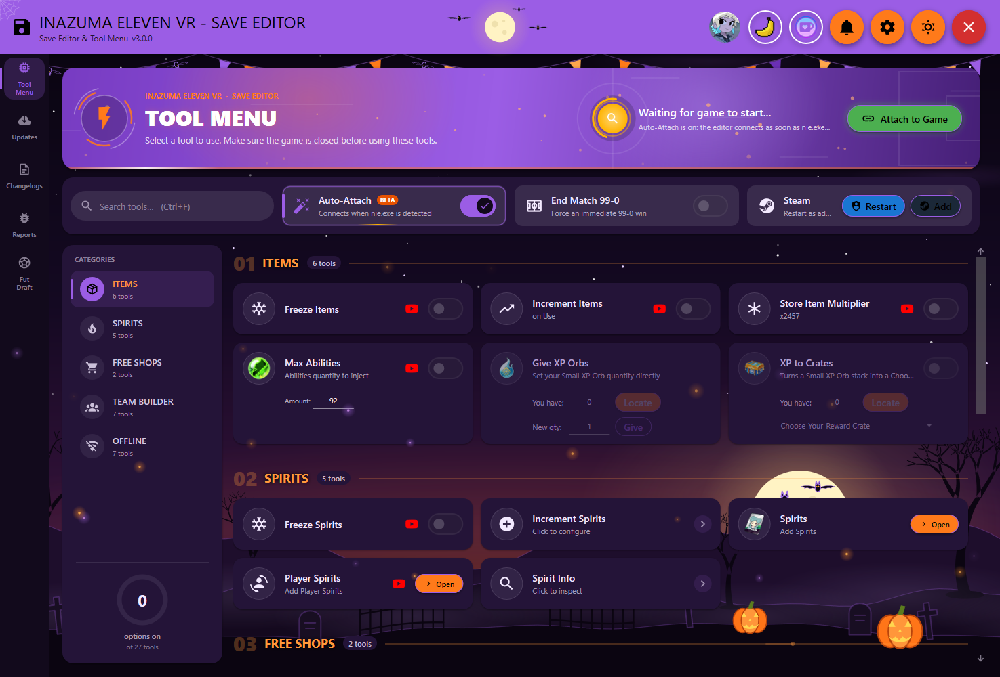
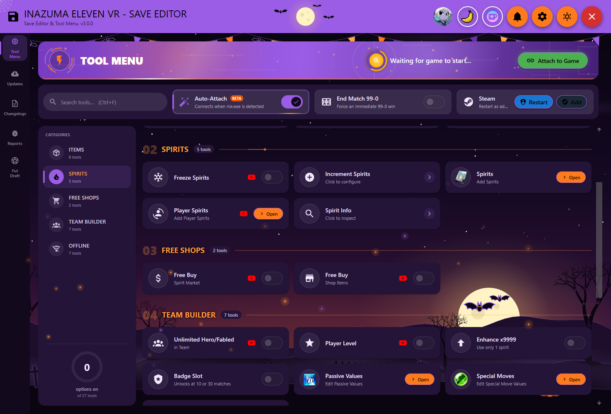
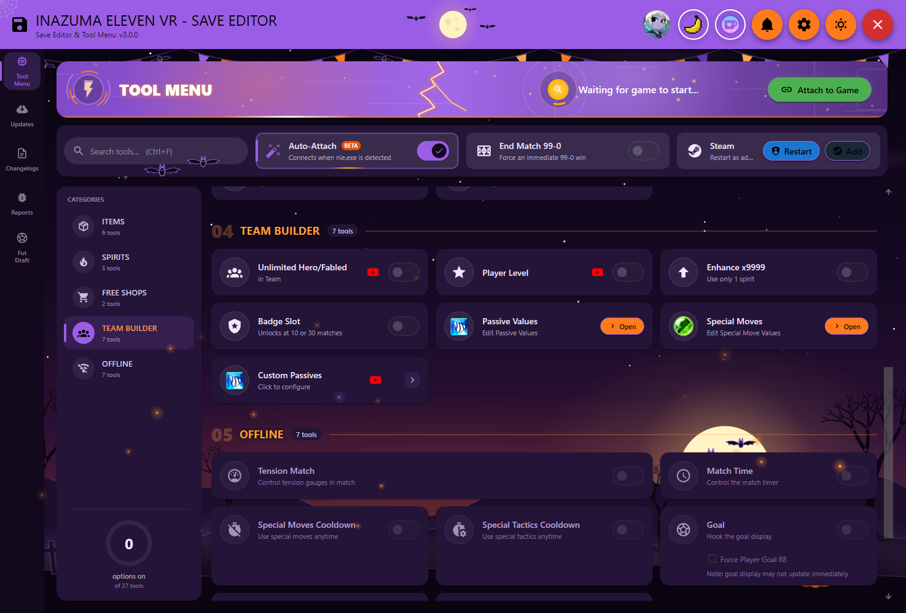
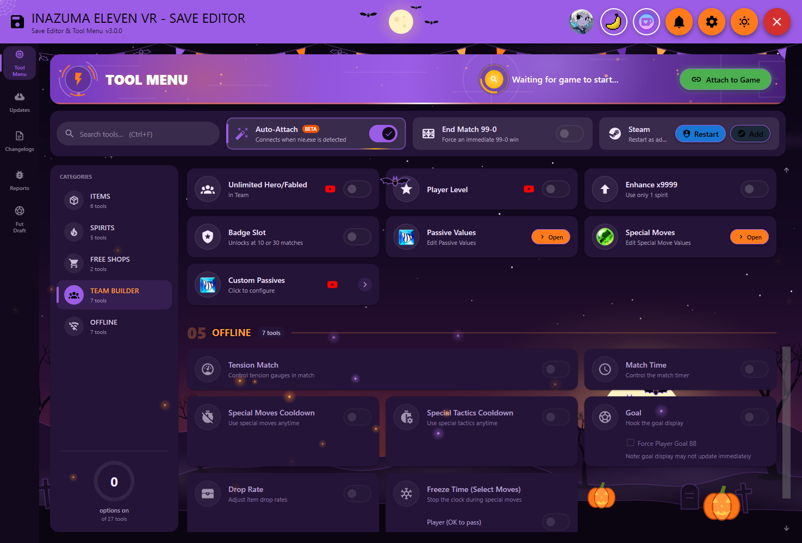
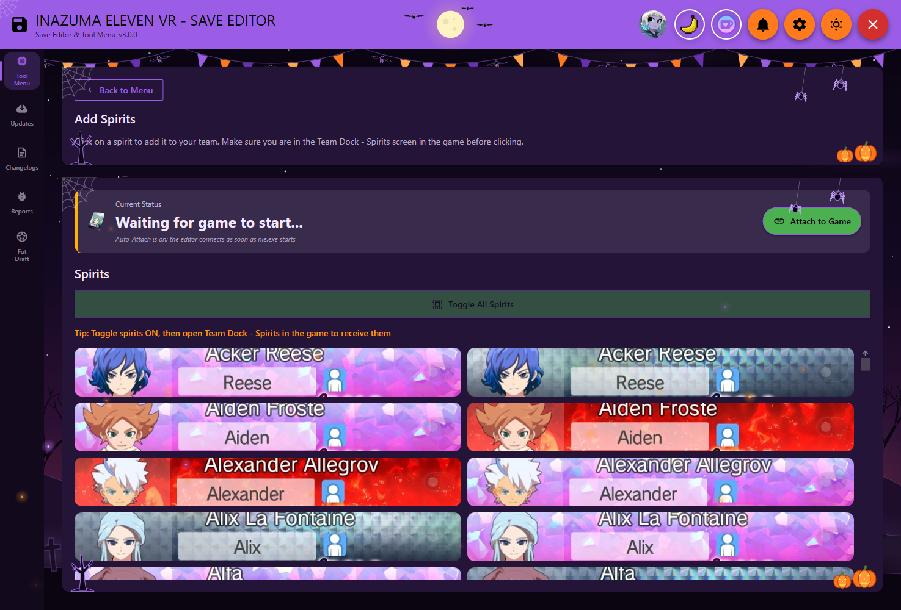
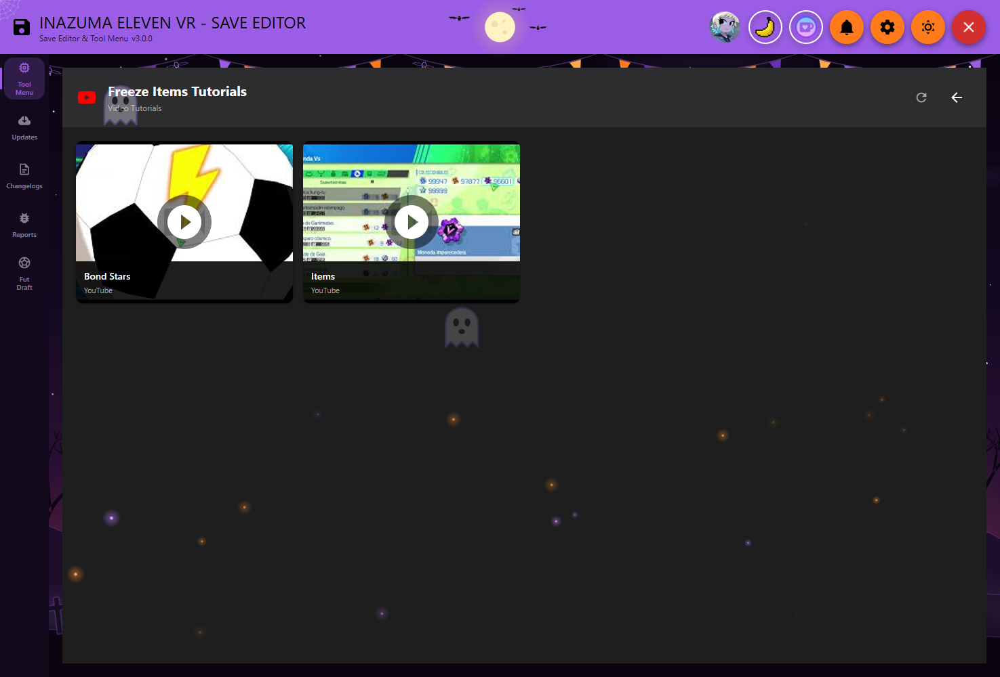
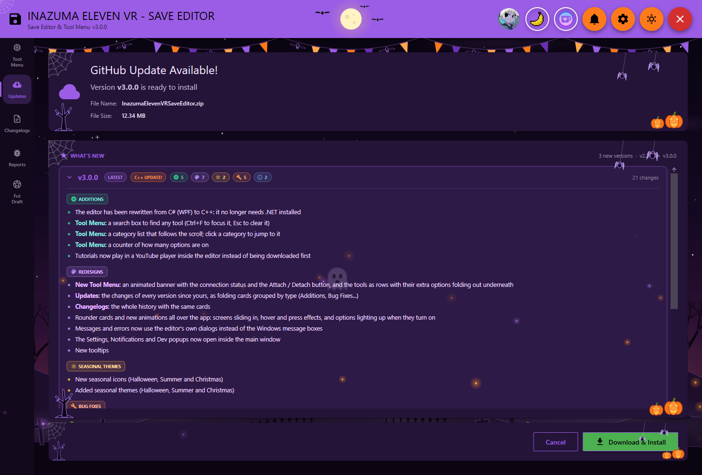
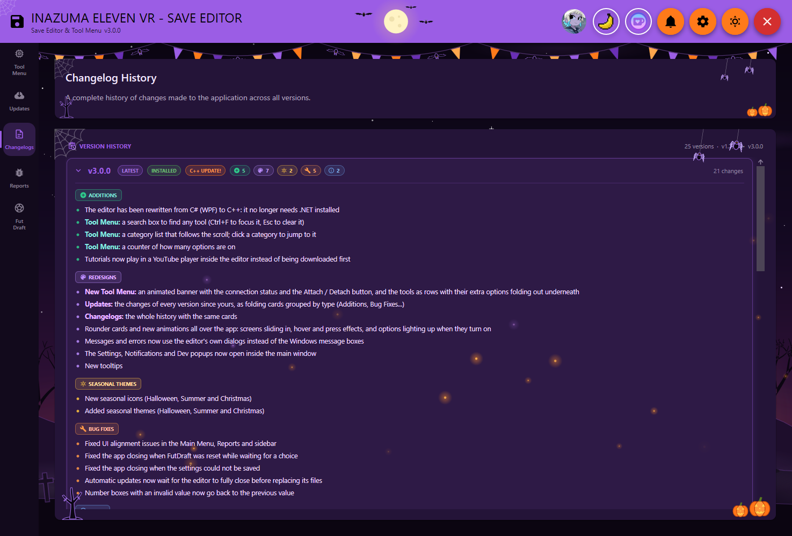
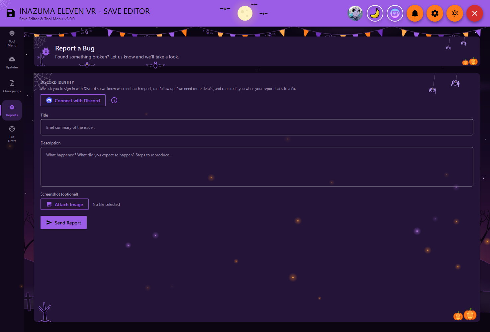

# Inazuma Eleven VR — Save Editor

**A save editor and Tool Menu for *Inazuma Eleven Victory Road*: freeze items and spirits, add hero spirits, boost your players, control your matches and more. Fully free, no strings attached.**

---

## What's new in 3.0.0

- **Rewritten from C# to C++** — no .NET needed anymore
- **New Tool Menu** — an animated banner with the connection status, a search box (`Ctrl+F`), a category list that follows the scroll and every tool as a row with its options folding out underneath
- **Updates and Changelogs** — every version's changes as folding cards, grouped by type (Additions, Redesigns, Bug Fixes…)
- **Tutorials** play inside the editor
- **Seasonal themes** for Halloween, Summer and Christmas

See [changelog.txt](changelog.txt) for the full history.

---

## Tool Menu

Everything is in one screen: search for a tool or jump to a category from the list on the left. The banner shows whether the editor is connected to the game, and the bar under it holds **Auto-Attach**, **End Match 99-0** and the **Steam** shortcuts (restart Steam as administrator, or add the editor to Steam as a game).

### Items
**Freeze Items** so they never decrease, **Increment Items on Use** so they go up instead of down, a **Store Item Multiplier x2457**, **Max Abilities** with a custom amount, **Give XP Orbs** and **XP to Crates** to turn a Small XP Orb stack into a Choose-Your-Reward or Victory Crate.

### Spirits & Free Shops
**Freeze Spirits**, **Increment Spirits on Use** for Hero/Fabled, Base and Custom spirits (with per-type amounts), **Player Spirits**, **Spirit Info**, and **Free Buy** in the Spirit Market and the item shop.

### Team Builder
**Unlimited Hero/Fabled** in your team, **Player Level**, **Enhance x9999** using only 1 spirit, **Badge Slot**, and the **Passive Values**, **Special Moves** and **Custom Passives** editors to tweak them directly.

### Offline matches
**Tension Match** (full gauges for you, empty for the rival), **Match Time** (zero, frozen or custom), **Special Moves / Special Tactics Cooldown**, **Goal**, **Drop Rate** and **Freeze Time** during special moves.

---

### Hero Spirit Roster
Add any of the **128 available hero spirits** to your team. Browse the full roster, toggle individual spirits or all at once, then open the Team Dock in-game to receive them.

---

### Tutorials
Most tools have a red YouTube button that opens their video tutorials right inside the editor.

---

### Updates, Changelogs & Reports
The editor checks GitHub for new versions and installs them in one click, showing what changed since your version. The **Changelogs** tab keeps the whole history, and **Reports** lets you send a bug report (with a screenshot) through Discord.

| | |
|---|---|
|  |  |

---

## How to Use

### Launch
1. **Close the game** if it's running
2. **Run the editor** (it asks for administrator rights) — it patches the EAC launcher automatically
3. **Launch the game** through Steam as normal

### Using the Tool Menu
1. With **Auto-Attach** on, the editor connects as soon as the game starts (or click **Attach to Game**)
2. Find the tool you want, or search for it with `Ctrl+F`
3. Turn its switch on, or click **Open** to edit its values in real time

### Adding Spirits
1. Open **Spirits → Add Spirits** in the Tool Menu
2. Browse the full roster and click any spirit to add it (or use **Toggle All Spirits**)
3. Open the **Team Dock** in-game to receive them

### Closing the Editor
- The editor **restores the original EAC launcher** when it closes — no manual cleanup required

---

## Important Notes

- **Always close the game** before launching the editor
- The editor manages EAC launcher patching and restoration on its own
- Values update in real time while the editor is attached to the game
- Freezing items or spirits stops them from decreasing

---

## Download

| Source | Link |
|--------|------|
| **GitHub (Recommended)** | [Latest Release](https://github.com/InazumaElevenVRSE/Inazuma-Eleven-VR-Save-Editor-Download/releases/latest) |
| **GameBanana** | [gamebanana.com/tools/21299](https://gamebanana.com/tools/21299) |
| **Website** | [ievrsaveeditor.com](https://ievrsaveeditor.com/) |

**Requirements:** Windows 10/11

---

## AI Assistance Notice

Artificial intelligence was used during development to help with code implementation and error correction.

---

## Support

If you enjoy this tool, consider supporting development on [Ko-fi](https://ko-fi.com/an_average_developer).

Made by **An Average Developer**
